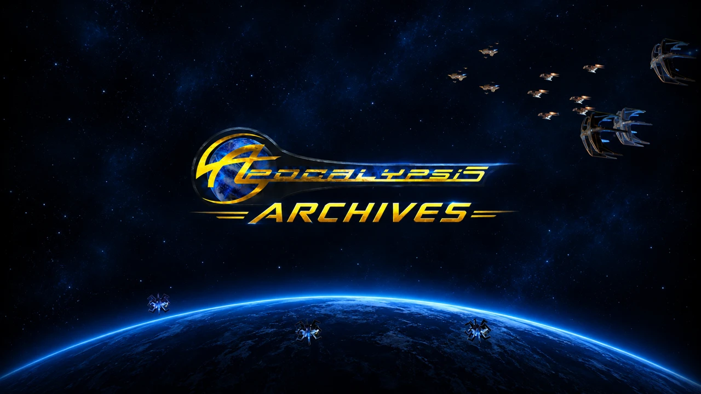

# Apocalypsis-Archives

*Sauvegarde des archives du jeu Apocalypsis*

---

**Accéder au site : <https://bfourquin.github.io/Apocalypsis-Archives/>**

Ce site a été créé dans le but de préserver **21 ans d'histoire** du jeu Apocalypsis et de la formidable créativité de sa communauté.

En dehors des nouvelles fonctionnalités, les archives sont présentées sous leur apparence d'origine, y compris pour le premier affichage de la Béta.

## Contenu

- **Parcourir** les archives : Gamma 1 et 2, Béta 1 à 3
- **Recherche** par titre, contenu ou auteur
- **Commandants et coalitions**
- **Statistiques**
- **Média** : roleplay, memes et illustrations

## Communauté

- Discord d'Apocalypsis : <https://discord.gg/y3U6wPZSpk>
- Contact sur le Discord : Paullus Beneradane – Iranis

## Propriété

> Les archives du jeu et de son forum restent la propriété des administrateurs d'Apocalypsis. Ce site n'en est qu'une copie de conservation, réalisée à titre non lucratif. Les messages demeurent l'œuvre de leurs auteurs, joueuses et joueurs d'Apocalypsis.
